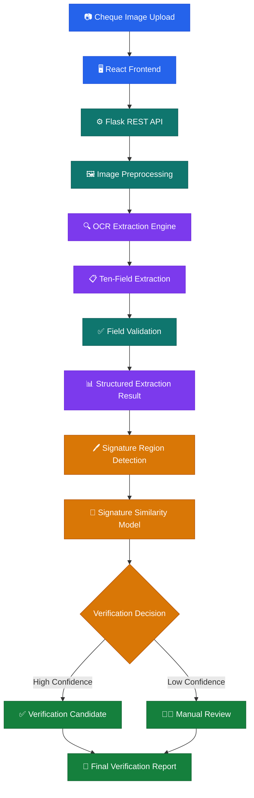
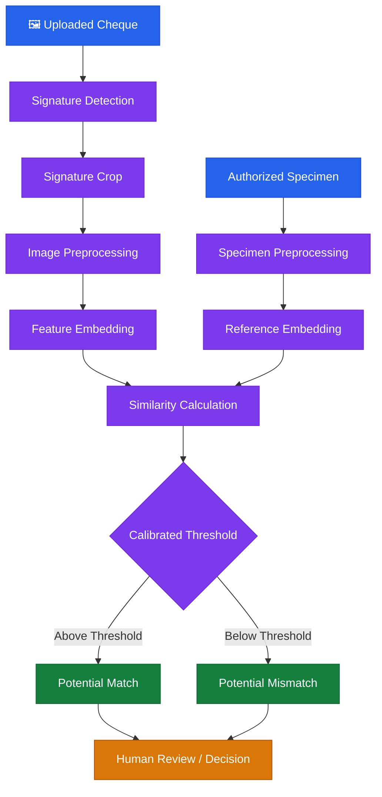
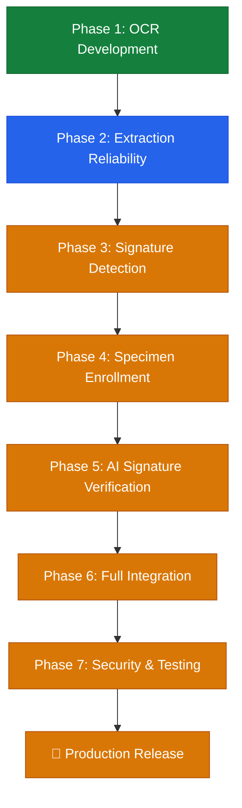

# 🏦 ChequeVerify AI
### Intelligent Cheque Processing, OCR Extraction & Signature Verification Platform

<p align="center">
  
  
  
  
</p>

<p align="center">
  <b>Automating cheque data extraction, intelligent validation and future-ready signature verification.</b>
</p>

<p align="center">
  <a href="#-overview">Overview</a> •
  <a href="#-architecture">Architecture</a> •
  <a href="#-features">Features</a> •
  <a href="#-roadmap">Roadmap</a> •
  <a href="#-installation">Installation</a>
</p>

---

## 🌟 1. Project Overview

**ChequeVerify AI** is an intelligent cheque processing and verification platform designed to reduce manual cheque data entry and support automated cheque validation using Optical Character Recognition (OCR), image processing, and machine learning.

The system accepts cheque images, extracts important banking information, validates extracted fields, and prepares structured results for further verification.

The long-term objective is to integrate signature detection, authorized signature enrollment, and AI-powered signature similarity analysis into a unified cheque verification workflow.

### 🎯 Project Objectives

- Automate cheque information extraction using OCR.
- Identify important cheque fields accurately.
- Validate extracted information using field-specific rules.
- Improve extraction performance across different bank cheque layouts.
- Detect and crop cheque signature regions.
- Compare cheque signatures with authorized specimen signatures.
- Generate structured verification reports.
- Support human review when automated verification is uncertain.

---

## 🖥️ 2. Project Highlights

| Component | Technology / Status |
|---|---|
| Frontend | React + TypeScript + Vite |
| Backend | Python + Flask |
| OCR Engine | PaddleOCR |
| Image Processing | OpenCV |
| Data Validation | Python validation pipeline |
| ML Components | Scikit-learn and model integration |
| Signature Verification | Planned development |
| API | Flask REST API |
| Database Integration | Future enhancement |

### 📊 Current Development Snapshot

- 10 cheque information fields targeted for extraction.
- 5 bank categories covered in the current regression work.
- 74 source and documentation files in the initial GitHub commit.
- OCR extraction pipeline and frontend/backend source included in the repository.

> These figures describe the current development scope and repository contents, not a guarantee of production accuracy or complete feature implementation.

---

## 🏗️ 3. System Architecture

The following diagram illustrates the intended end-to-end architecture.



*Note: Signature detection, signature similarity and the complete final decision workflow are planned integration stages, not confirmed completed functionality.*

---

## 🔍 4. OCR Extraction Pipeline

The current extraction pipeline targets the following ten cheque fields:

| No. | Field | Description |
|---:|---|---|
| 1 | Bank Name | Identifies the issuing bank |
| 2 | Cheque Number | Extracts the cheque identification number |
| 3 | MICR Code | Extracts the MICR information |
| 4 | Account Number | Extracts the account number |
| 5 | Date | Identifies the cheque date |
| 6 | Payee Name | Extracts the beneficiary name |
| 7 | Amount in Figures | Reads the numerical amount |
| 8 | Amount in Words | Extracts the written amount |
| 9 | IFSC Code | Identifies the bank branch code |
| 10 | Branch Name | Extracts branch information |

### 🔄 Extraction Workflow


The extraction pipeline includes field-specific parsing and normalization logic for banking information, including date handling, IFSC validation, MICR parsing, cheque number extraction, and amount normalization.

---

## ✨ 5. Implemented Features

### ✅ Backend
- Flask application and REST API.
- Image upload and cheque processing endpoints.
- PaddleOCR integration.
- Ten-field extraction pipeline.
- Field validation and normalization.
- Bank-specific extraction improvements.
- Confirmed-label handling without automatically replacing model predictions with ground-truth labels.
- OCR diagnostics and evaluation scripts.

### ✅ Frontend
- React + TypeScript + Vite application.
- Dashboard interface.
- Frontend testing configuration.
- API integration foundation.

### ✅ Testing and Improvements
- OCR regression testing framework.
- Bank-specific extraction improvements.
- Syndicate Bank extraction patch and five-image API regression.
- Axis Bank and ICICI Bank test investigations.
- Testing reports and project documentation.

---

## 🚧 6. Remaining Development Work

The following tasks represent the next major development milestones.

### Phase 1 — OCR Accuracy & Reliability

- [ ] Complete full regression testing across all available cheque images.
- [ ] Verify extracted fields against manually confirmed ground truth.
- [ ] Resolve remaining bank-specific extraction errors.
- [ ] Improve MICR and cheque-number recognition.
- [ ] Improve amount-in-words and numerical amount consistency.
- [ ] Evaluate field-wise precision, recall and accuracy.
- [ ] Generate a consolidated bank-wise evaluation report.

### Phase 2 — Signature Detection & Cropping

- [ ] Identify cheque signature regions.
- [ ] Develop signature-region detection and cropping.
- [ ] Improve image quality and remove background noise.
- [ ] Normalize signature dimensions.
- [ ] Handle rotated, faint and low-resolution signatures.
- [ ] Create a signature preprocessing pipeline.

### Phase 3 — Authorized Signature Enrollment

- [ ] Develop authorized-user registration.
- [ ] Capture and store specimen signatures.
- [ ] Support multiple specimen signatures per authorized user.
- [ ] Implement secure specimen storage.
- [ ] Build a signature enrollment management interface.

### Phase 4 — AI Signature Verification

- [ ] Develop a Siamese Neural Network or signature embedding model.
- [ ] Generate feature representations of signature images.
- [ ] Compare cheque signatures with authorized specimens.
- [ ] Calibrate similarity thresholds using validation data.
- [ ] Evaluate false acceptance and false rejection rates.
- [ ] Test genuine and forged signature samples.
- [ ] Add an uncertain-result/manual-review mechanism.

### Phase 5 — Frontend & Backend Integration

- [ ] Complete cheque upload and processing UI.
- [ ] Display extracted cheque fields.
- [ ] Show field-level validation results.
- [ ] Display signature detection and comparison results.
- [ ] Build verification history.
- [ ] Generate downloadable verification reports.
- [ ] Improve error handling and API response consistency.

### Phase 6 — Security, Testing & Deployment

- [ ] Add authentication and role-based access.
- [ ] Secure uploaded cheque images and specimen signatures.
- [ ] Implement appropriate data retention controls.
- [ ] Add API integration and end-to-end tests.
- [ ] Optimize processing speed.
- [ ] Complete production configuration.
- [ ] Deploy frontend and backend.
- [ ] Perform final system validation.

---

## 🧠 7. Planned Signature Verification Architecture

Signature verification is a major upcoming feature.

The planned approach uses image preprocessing and deep-learning-based feature comparison.



### Proposed Model Components

| Component | Purpose |
|---|---|
| OpenCV | Image preprocessing |
| Signature Detection | Locate signature region |
| Siamese Network | Learn signature similarity |
| Embedding Model | Extract signature features |
| Similarity Metric | Compare feature vectors |
| Threshold Calibration | Classify match confidence |
| Human Review | Handle uncertain cases |

**Important:** A similarity score is not definitive proof of authenticity. The model must be evaluated against representative genuine and forged samples, and uncertain cases should be reviewed by an authorized person.

---

## 🛠️ 8. Technology Stack

<p>
  
  
  
  
  
  
  
  
  
</p>

| Layer | Technology |
|---|---|
| Programming Language | Python |
| Backend Framework | Flask |
| Frontend Framework | React |
| Frontend Language | TypeScript |
| Build Tool | Vite |
| OCR | PaddleOCR |
| Image Processing | OpenCV |
| Machine Learning | Scikit-learn |
| Version Control | Git & GitHub |

---

## 📁 9. Project Structure

```text
ChequeA/
│
├── backend/
│   ├── api/
│   │   └── routes.py
│   ├── models/
│   │   ├── ocr_extractor.py
│   │   ├── ocr_extractor_local.py
│   │   ├── quality_analyzer.py
│   │   ├── verification_model.py
│   │   ├── vlm_extractor.py
│   │   └── vlm_extractor_local.py
│   ├── utils/
│   │   ├── cheque_fields.py
│   │   ├── confirmed_labels.py
│   │   ├── field_extraction_pipeline.py
│   │   └── validators.py
│   ├── app.py
│   ├── config.py
│   ├── requirements.txt
│   └── verification_service.py
│
├── Frontend/
│   ├── src/
│   │   ├── App.tsx
│   │   ├── main.tsx
│   │   └── index.css
│   ├── tests/
│   ├── package.json
│   └── vite.config.ts
│
├── docs/
│   ├── API_DOCUMENTATION.md
│   ├── CURRENT_IMPLEMENTATION.md
│   ├── DEVELOPMENT_ROADMAP.md
│   ├── PROJECT_OBJECTIVES.md
│   ├── SIGNATURE_VERIFICATION_DESIGN.md
│   └── SYSTEM_ARCHITECTURE.md
│
├── scripts/
│   ├── audit/
│   ├── dataset/
│   ├── diagnostics/
│   ├── evaluation/
│   └── maintenance/
│
├── training/
│
├── .gitignore
├── README.md
├── start.ps1
└── Install-ChequeVerifyAI-ReactTS.ps1
```

---

## ⚙️ 10. Installation

### Prerequisites

- Python 3.12 recommended for the current backend environment.
- Node.js and npm.
- Git.
- Windows, Linux or macOS.

### Step 1 — Clone Repository

```bash
git clone https://github.com/nvaltryek-001/Cheque.git
cd Cheque
```

### Step 2 — Setup Python Backend

```powershell
cd backend

python -m venv .venv

.\.venv\Scripts\Activate.ps1

pip install --upgrade pip

pip install -r requirements.txt
```

### Step 3 — Start Flask Backend

```powershell
python app.py
```

### Step 4 — Setup Frontend

Open another terminal:

```powershell
cd Frontend

npm install

npm run dev
```

### Step 5 — Access Application

Open the local development URL displayed by Vite in your browser.

> Exact API endpoints, environment variables and startup requirements should be checked against the current source files before production deployment.

---

## 🧪 11. Testing Strategy

Testing will cover the following areas:

| Testing Area | Objective |
|---|---|
| OCR Testing | Check text extraction |
| Field Validation | Verify extracted values |
| Bank-wise Testing | Evaluate different cheque layouts |
| Regression Testing | Detect performance regressions |
| API Testing | Validate backend responses |
| Frontend Testing | Check dashboard workflows |
| Signature Testing | Evaluate genuine and forged samples |
| Integration Testing | Verify complete processing flow |

### OCR Evaluation Metrics

- Field-wise accuracy.
- Precision.
- Recall.
- F1-score.
- Processing time.
- Percentage of missing fields.
- Bank-wise performance.

A populated field is not automatically a correct field. Final accuracy must be measured against verified ground-truth labels.

---

## 🗺️ 12. Development Roadmap



| Milestone | Current Position |
|---|---|
| Initial backend and frontend | Implemented foundation |
| OCR integration | Implemented |
| Ten-field extraction | Implemented foundation |
| Bank-wise reliability | Ongoing validation |
| Signature detection | Planned |
| Specimen enrollment | Planned |
| AI signature verification | Planned |
| Full integration | Planned |
| Production deployment | Planned |

---

## 🔐 13. Security & Privacy

Cheque images and banking information are sensitive.

The project should follow these principles:

- Never commit real cheque images or private banking datasets.
- Never publish API keys, passwords or environment secrets.
- Store specimen signatures securely.
- Restrict access to authorized users.
- Use encrypted communication in production.
- Avoid exposing account numbers in logs and reports.
- Define secure data retention and deletion policies.
- Maintain audit logs for sensitive verification operations.

---

## 🎯 14. Future Enhancements

- Advanced deep-learning OCR.
- Automated bank layout classification.
- Improved MICR recognition.
- AI-powered signature verification.
- Cheque tampering and alteration detection.
- Duplicate cheque detection.
- Risk scoring and anomaly detection.
- Verification history and analytics dashboard.
- Secure report generation.
- Production-ready cloud deployment.

---

## 📌 15. Project Status

**Current stage:** OCR implementation and reliability improvement.

The foundational frontend, backend, OCR extraction and validation components have been developed. The next major objective is to complete comprehensive OCR evaluation and build the signature detection and verification pipeline.

This is an actively developing project. Features listed in the roadmap are planned unless explicitly identified as implemented.

---

## 👨‍💻 16. Repository & Contribution

**GitHub Repository:**  
https://github.com/nvaltryek-001/Cheque

**Default Branch:** `main`

Contributions, suggestions, testing feedback and technical improvements are welcome.

To contribute:

1. Fork the repository.
2. Create a feature branch.
3. Implement and test your changes.
4. Submit a pull request with a clear description.

---

<p align="center">
  <b>🏦 ChequeVerify AI</b>
  <br/>
  <i>From cheque image processing to intelligent verification.</i>
  <br/><br/>
  Built with Python, React, OCR and AI.
</p>
