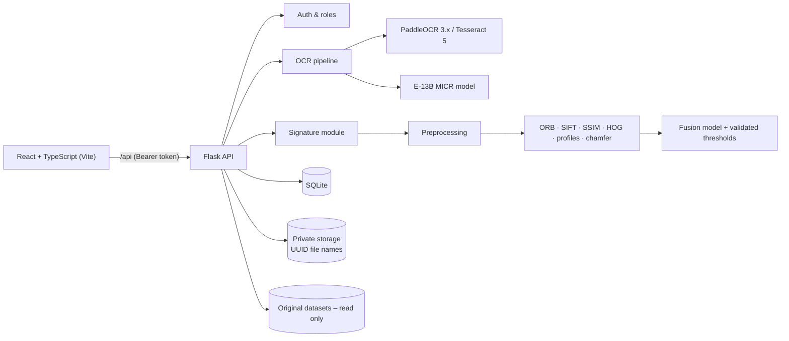

# ChequeVerify AI

Cheque OCR, field validation and signature verification for Indian CTS-2010 cheques –
a Flask + React (TypeScript) web application with role-based access, full CRUD,
audit logging, dataset auditing, model training/evaluation and PDF/CSV reporting.

> **Decision support, not a guarantee.** Every OCR value carries a confidence and a
> review status, and every signature result is MATCH / REVIEW / MISMATCH with its
> reasons. An authorised person makes the final call.

---

## 1. Problem and objectives

Banks still key in cheque details by hand and compare signatures by eye. This project:

1. Extracts the ten cheque fields from an image and validates them (IFSC format, bank/IFSC
   consistency, amount-in-words vs figures, date validity, MICR/cheque-number format).
2. Lets an administrator enroll authorised signers with one or more specimen signatures.
3. Compares the signature on a cheque with the enrolled specimens and returns an
   explained MATCH / REVIEW / MISMATCH decision for manual confirmation.
4. Keeps a complete, exportable record (history, audit trail, PDF and CSV reports).
5. Is honest about what the available data can and cannot support.

## 2. Features

| Area | What works |
|---|---|
| Cheque OCR | Upload → quality check → OCR (PaddleOCR 3.x if installed, else Tesseract 5) → 10 fields with confidence/source/status → validation checks → automatic signature crop |
| MICR | Dedicated E-13B reader (template model learned from the train split) for cheque number + MICR code |
| Review | Edit any field; machine values are preserved and edits stored as corrections; reviewer notes; mark reviewed |
| Batch | Up to 20 cheques per batch |
| Enrollment | Signer CRUD, signing sessions (day, method, consent reference), multi-file upload into a session, reference-set readiness (independent specimens × signing days), quality gate, duplicate and same-signing detection, replace/deactivate/delete, enrollment history, bulk `import-collection`, dataset import – see `docs/SIGNATURE_ENROLLMENT.md` |
| Verification | From a processed cheque (auto or manual crop) or an uploaded image; compares against all active specimens; reasons, feature scores, threshold scale; manual approve/reject. A `MATCH` is only issued when the signer's reference set is ready (otherwise it is lowered to `REVIEW`) |
| Datasets | Live audits of both datasets; manifest-based browser; **open a sample cheque and press *Process with OCR*** to run it through the same pipeline as an upload (the file is only read) |
| Models | Readiness assessment; background training/evaluation jobs with history and metrics |
| Reports | Per-cheque PDF; CSV exports (cheques, verifications, signers, audit log); audit/evaluation report downloads |
| Security | Token auth (password or mailed one-time code for `@saividya.ac.in` addresses, new accounts wait for approval), 3 roles, per-client sign-in throttling, per-user rate limits, password policy, token revocation, upload validation by content (size and pixel limits before decoding), CSP/HSTS and other headers, private storage, audited biometric access, masked account numbers, pre-push audit for private data |

### Screens
Dashboard · Cheque verification · Cheque detail · Signature verification · Signature enrollment ·
Signer detail · Batch processing · OCR dataset · Signature dataset · Model training · Analytics ·
Verification history · Reports · Settings (thresholds, users and roles, password, audit log), plus the sign-in and
waiting-for-approval pages. The interface uses one design system (midnight-ink navigation, ultramarine actions,
an aqua scan accent only where images are analysed, self-hosted Inter fonts under the SIL OFL) described in
`docs/ARCHITECTURE.md`.

## 3. Architecture



Cheque workflow: upload → validate file (magic bytes, size, decode) → image quality → OCR + MICR →
10 fields → validation → signature detection/crop → (account number suggests an enrolled signer) →
operator review → signature comparison (only if the signer has an active specimen) → manual
approve/reject → PDF report → every step written to the audit log.

## 4. Technology

Backend: Python 3.12+, Flask 3, OpenCV, NumPy, ReportLab, SQLite (stdlib), Waitress (production).
OCR: PaddleOCR 3.x (auto-detected) or the Tesseract 5 binary. Frontend: React 18, TypeScript 5,
Vite 5 – no UI library; icons are inline SVG. Tests: pytest, Playwright (end-to-end, run during development).

## 5. Folder structure

```text
ChequeVerify/
├── backend/
│   ├── app/
│   │   ├── __init__.py          app factory, error handling, security headers, serves Frontend/dist
│   │   ├── config.py            all settings (env vars / backend/.env)
│   │   ├── db.py                SQLite schema + helpers
│   │   ├── api/                 auth_routes, cheque_routes, signer_routes, verification_routes, system_routes
│   │   ├── ocr/                 engine.py, fields.py, regions.py, micr.py, amounts.py, quality.py, evaluate.py
│   │   ├── signature/           preprocess.py, compare.py, detect.py, training.py
│   │   └── services/            auth, audit, storage, cheques, enrollment, datasets, jobs, models, reports
│   ├── models_store/            micr_e13b.npz, signature_fusion.json (trained artefacts)
│   ├── tests/                   pytest suite (54 tests)
│   ├── manage.py                CLI: audit, train-micr, train-signature, eval-ocr, create-user, reset-password
│   ├── run.py / wsgi.py         dev + production entry points
│   ├── requirements.txt
│   └── .env.example
├── Frontend/
│   ├── src/                     main.tsx, App.tsx, api.ts, auth.tsx, router.ts, styles.css, components/, pages/
│   ├── dist/                    production bundle from `npm run build` (not committed)
│   ├── package.json, vite.config.ts, tsconfig.json, index.html
├── docs/                        API.md, ARCHITECTURE.md, OCR_DATASET.md, SIGNATURE_DATASET.md, SIGNATURE_ENROLLMENT.md,
│                                SIGNATURE_EVALUATION_PROTOCOL.md, SECURITY.md
├── reports/final/               audits, evaluations, test results, completion report
├── dataset/                     ← put the OCR dataset here (train/ vaildate/ test/ <bank>/)
├── signature/                   ← put the signature dataset here (genuine_signatures.csv …)
├── legacy/                      the previous implementation (v1), kept unchanged
├── Dockerfile, render.yaml      container + Render deployment
├── .github/workflows/ci.yml     tests, frontend build, Docker smoke test
├── start.ps1 / start.sh         one-command setup, run, dev mode and tests
└── README.md
```

## 6. Datasets

**OCR dataset (`dataset/`)** – 120 cheque images, 4 banks (Axis, Canara, ICICI, Syndicate),
split 80/20/20 (5 per bank in val and test), no corrupted files, no exact duplicates or cross-split
filename leakage. **There are no transcription labels**, and the filled-in fields are machine-printed,
not handwritten (only the signature is handwritten). The only labels are weak: bank and split from
folders, and the cheque number = filename stem (119/120 files). See `docs/OCR_DATASET.md`.

**Signature dataset (`signature/`)** – 120 genuine specimens (one per signer, 120 signers),
240 synthetic alterations (2 per signer: random added/erased strokes), manifests valid, no missing or
corrupted files, no signer in more than one split. One specimen per signer means signer-specific or
Siamese training is **blocked**. See `docs/SIGNATURE_DATASET.md`.

**Demo samples.** Sign in, open *OCR dataset* in the navigation, click any image and press *Process with OCR*: the server reads that file
from its dataset folder (`dataset/`, or `CV_OCR_DATASET`), runs the normal upload pipeline and opens the result. Nothing is generated or
faked, the original file is not changed, and the result is labelled as a dataset sample. This needs the dataset folder on the machine
that runs the server: on the Docker/Render copy the folder is empty by design (the datasets are private), so load cheques there with
*Batch upload* or the upload box.

## 7. Models and results (held-out test split, measured – not estimated)

| Component | What was trained | Test result |
|---|---|---|
| MICR E-13B reader | 480 glyph templates from 80 train cheques (labels = filename cheque number) | Cheque number exact match **20 of 20** test cheques (19/19 val). 95 % lower confidence bound ≈ 83 %. |
| Field extraction (Tesseract 5.3.4) | Rules + region isolation; refined in phase 1 (2026-10-31) on the train, validation and test splits | Against labels for the 20 test cheques (transcribed by the AI assistant, **not human-verified**): **196/200 fields correct**, 0 wrong values marked ok, the 4 wrong ones flagged for review; bank, cheque no., MICR 20/20. The split is **not blind** (the rules were tuned on it), so accuracy on unseen cheques will be lower - by an unmeasured amount |
| Handwritten OCR | — | **Blocked**: no handwritten fields, no transcriptions |
| Signature fusion (logistic regression over 8 similarity features) + alteration check | Fusion on train pairs, thresholds on validation, alteration thresholds on train | Different signer: 0/60 accepted. Script-made edit of the specimen (an *edited copy*, not a forgery by another person) submitted as-is: **2/40 accepted**, 21/40 rejected, 17/40 review (before the alteration check every as-is edited copy was accepted). MATCH on any negative 1.4 %. Simulated genuine re-captures mostly go to REVIEW (45/60). **These figures say nothing about real genuine signatures or skilled forgeries** – see `docs/SIGNATURE_EVALUATION_PROTOCOL.md` |
| Signer-specific / Siamese | — | **Blocked**: needs several real specimens per signer |

Full numbers, protocol and caveats: `reports/final/MODEL_EVALUATION.md`.
Positive signature pairs are *simulated re-captures* of the single genuine image, because the dataset
has no second genuine specimen – this is the main limitation of the signature results.

## 8. Installation (Windows – your existing machine)

Prerequisites: Python 3.12 (your `.venv312` works), Node.js 18+, and an OCR engine:
either your existing PaddleOCR 3.x environment (auto-detected) or
[Tesseract for Windows](https://github.com/UB-Mannheim/tesseract/wiki).

```powershell
cd N:\Cheque\ChequeVerify          # wherever you unzipped the project
# 1. datasets (copied or pointed to – originals are never modified)
#    either copy them to .\dataset and .\signature, or set paths in backend\.env
copy backend\.env.example backend\.env
notepad backend\.env               # e.g. CV_OCR_DATASET=N:\Cheque\ChequeA\dataset
                                   #      CV_SIGNATURE_DATASET=N:\Cheque\ChequeA\signature
# 2. install
.\start.ps1 -Setup
# 3. test
.\start.ps1 -Test
# 4. run (production build, one process, http://127.0.0.1:5000)
.\start.ps1
# or development mode with hot reload (Flask :5000 + Vite :5173)
.\start.ps1 -Dev
```

If PowerShell blocks the script: `Set-ExecutionPolicy -Scope Process Bypass`.

Manual equivalent:

```powershell
python -m venv .venv ; .\.venv\Scripts\Activate.ps1
pip install -r backend\requirements.txt
cd Frontend ; npm install ; npm run build ; cd ..
cd backend ; python -m pytest -q ; python run.py --prod
```

Linux/macOS: `./start.sh setup`, `./start.sh test`, `./start.sh`, `./start.sh dev`
(`sudo apt install tesseract-ocr` for the OCR engine).

**First sign-in.** On first start the backend creates user `admin` and prints a random password in
the terminal (or uses `CV_ADMIN_PASSWORD` from `.env`). Choose *Administrator sign-in* on the login screen,
change the password under Settings → Your password, then create operator/auditor accounts under Settings → Users.

**Sign in by institutional email.** People with an `@saividya.ac.in` address sign in without a password: they enter
the address, then the 8-digit code that is emailed to them. No list of people is kept; the first sign-in creates an
account that waits for an administrator to give it a role (Settings → Users and roles). It needs a mail server
(`CV_EMAIL_DELIVERY` and `CV_SMTP_*`); for local trials `CV_EMAIL_DELIVERY=log` prints the code in the server log.
How it works, what it does and does not prove, and how to set it up: `docs/AUTHENTICATION.md`.

Suggested first steps in the app: Signature enrollment → *Import from dataset* (creates the 120 signers),
then Cheque verification → upload a cheque from `dataset/test/...` → Verify signature.

### Deploy (Docker / Render)

```bash
docker build -t chequeverify .
docker run -p 8000:8000 -e CV_ADMIN_PASSWORD='Choose-a-strong-one-123' -v chequeverify-data:/data chequeverify
```
Or connect this repository to Render as a Blueprint (`render.yaml`). Full guide: `docs/DEPLOYMENT.md`.
Shortcut that opens Render's Blueprint page with this repository and the `chequeverify-v2` branch filled in (a paid Starter plan with a 1 GB disk; Render asks for `CV_ADMIN_PASSWORD`):
<https://render.com/deploy?repo=https://github.com/nvaltryek-001/Cheque/tree/chequeverify-v2>
GitHub Actions (`.github/workflows/ci.yml`) runs the backend tests, the Vite build, a dependency audit, the private-data audit
and, in a real container, the live smoke test, persistence across restart, redeploy and hard kill, a clean `docker stop`, the
reverse-proxy headers and a 512 MB memory check (results: `reports/final/DEPLOYMENT_VERIFICATION.md`).

The Docker image accepts images up to **12 megapixels** (`CV_MAX_IMAGE_PIXELS`; larger ones are refused with `413 image_too_large`)
and processes two at a time (`CV_MAX_CONCURRENT_IMAGES`; others wait, then get `503 busy`), so it fits a 512 MB instance.
Raise both on a host with more memory. **The hosted copy starts empty**: the private datasets are not in git or in the image;
sign in as administrator and use *Batch upload* to load cheques. A cheque takes about 4 s of OCR on 2 CPUs (a small hosted
instance is slower).

The previous implementation (v1) is preserved unchanged under `legacy/`.

## 9. Configuration (`backend/.env`)

| Variable | Default | Meaning |
|---|---|---|
| `CV_OCR_DATASET`, `CV_SIGNATURE_DATASET` | `dataset`, `signature` | Dataset locations (absolute or relative to project root) |
| `CV_OCR_ENGINE` | `auto` | `auto`, `paddle`, `tesseract`, `none` |
| `CV_TESSERACT_CMD` | PATH / `C:\Program Files\Tesseract-OCR\tesseract.exe` | Tesseract binary |
| `CV_SECRET_KEY` | random, stored in `backend/instance/secret_key` | Token signing key |
| `CV_ADMIN_PASSWORD` | random, printed once | First admin password |
| `CV_EMAIL_DELIVERY`, `CV_SMTP_HOST`, `CV_SMTP_PORT`, `CV_SMTP_SECURITY`, `CV_SMTP_USER`, `CV_SMTP_FROM`, `CV_SMTP_PASSWORD` | off | Mail delivery for email sign-in (`smtp`; `log` is for development only). The SMTP password is a secret: environment only |
| `CV_EMAIL_DOMAINS`, `CV_EMAIL_DEFAULT_ROLE`, `CV_ADMIN_EMAILS`, `CV_PASSWORD_LOGIN` | `saividya.ac.in`, `pending`, empty, `1` | Who may sign in by email, what a first sign-in becomes, which addresses become administrators, whether password sign-in stays on (see `docs/AUTHENTICATION.md`) |
| `CV_MAX_UPLOAD_MB` | 10 | Upload limit |
| `CV_CORS_ORIGINS` | localhost:5173 | Only needed when the UI is served from another origin |
| `CV_TOKEN_MAX_AGE` | 28800 | Session lifetime (seconds) |
| `CV_INSTANCE_DIR`, `CV_STORAGE_DIR`, `CV_DATABASE`, `CV_MODELS_DIR`, `CV_REPORTS_DIR` | under backend/ | Storage locations |

## 10. Command-line tasks

```bash
cd backend
python manage.py audit                    # both dataset audits -> reports/final/*_AUDIT.json
python manage.py train-micr               # MICR templates (train) + val/test evaluation
python manage.py train-signature          # fusion (train) + thresholds (val) + test evaluation
python manage.py eval-ocr --split test    # field-extraction evaluation
python manage.py create-user alice --role operator
python manage.py reset-password admin
python -m pytest -q                       # the backend test suite
```
The same jobs can be started from the Model training screen (admin).

## 11. Security

Summary (details in `docs/SECURITY.md` and `reports/final/SECURITY_AUDIT.md`): signed bearer tokens
with server-side revocation, three roles enforced on every endpoint, enrollment admin-only, specimen
images never public (admin/operator only, each view audited), uploads validated by content and stored
under random names, path-traversal protection on every file endpoint, no stack traces or paths in
errors, CSV formula-injection protection, account numbers masked in lists/exports/PDF, per-client sign-in
throttling, per-user rate limits, password policy, strict CORS allow-list, Content-Security-Policy, HSTS and
other security headers, `scripts/prepush_audit.py` against private data in git. **Not production-banking
ready** without HTTPS, an external identity provider/MFA, encrypted storage, retention policies and an
independent security test (open items: `docs/SECURITY.md`).

## 12. Limitations

- The OCR dataset has no text labels: field accuracy can only be measured for the cheque number;
  other fields are checked by self-consistency and cross-reference, not ground truth. Staff
  corrections made in the app are the start of a real labelled set.
- Fields on these cheques are typed; real handwritten cheques will perform worse with Tesseract.
- Test cheques share templates with training cheques, so results on unseen layouts will be lower.
- Signature verification: one specimen per signer, synthetic alterations only, simulated positive pairs,
  20 test signers. An alignment-based check rejects most edited copies, but ~10 % of the synthetic
  edits contain no visible change and cannot be detected; behaviour on real, independently signed
  genuine signatures and on skilled forgeries is untested and, with this data, **not measurable**
  (`reports/final/SIGNATURE_EVALUATION_STATUS.md`). The application does not claim to detect forged signatures.
- In this dataset the enrolled specimens were cropped from the same cheque scans, so verifying those
  cheques against them is not an independent test (the copy check sends these to REVIEW as near-identical copies).
- PaddleOCR adapter follows the documented 3.x API but was not executed in the build environment.
- The OCR labels were transcribed by the AI assistant and the test split is not blind: the 196/200 figure is an upper
  bound for unseen cheques, not an estimate of them. Four banks and clean flat scans only; phone photographs are untested.
- Speed: about 4 s of OCR per cheque on 2 CPUs; eight uploads at once take about 18 s in total. A small hosted instance is slower.
- Not verified: a real Render deployment, real email delivery (SMTP), and the Render disk's behaviour (documentation only).

## 13. Future scope

Collect genuine specimens over several days and real skilled forgeries (`docs/SIGNATURE_ENROLLMENT.md`), evaluate with
`docs/SIGNATURE_EVALUATION_PROTOCOL.md`, and only then consider a metric-learning model;
label handwritten field crops (the review screen already records corrections) and fine-tune PaddleOCR
recognition; layout detection for unseen templates; MFA/SSO; encrypted object storage; PostgreSQL.

## 14. Troubleshooting

| Symptom | Fix |
|---|---|
| "No OCR engine available" | Install Tesseract or activate the PaddleOCR environment; set `CV_TESSERACT_CMD` |
| Fields all "missing" except cheque number | Same as above – MICR works without an OCR engine |
| Dataset screens say "not found" | Set `CV_OCR_DATASET` / `CV_SIGNATURE_DATASET` in `backend/.env` |
| Forgot admin password | `python manage.py reset-password admin` |
| Account locked | Wait 5 minutes or reset the password |
| `npm run build` type errors | `cd Frontend && npm install` (types come from `@types/react`) |
| Port 5000 busy | `.\start.ps1 -Port 8000` |
| Console errors for `/api/foods`, a `main.tsx` MIME type or a service worker | This frontend has no service worker and no `/api/foods` call, and it talks to the API on its own address. Another app (or an older copy) was served on the same address, for example `localhost:5173`, and left a service worker in the browser. DevTools → Application → Service Workers → Unregister, then "Clear site data" and reload (or use another port). Run the app from `Frontend/`, not `legacy/Frontend`. |
| `413 image_too_large` | The image has more pixels than `CV_MAX_IMAGE_PIXELS` (12 megapixels in the Docker image, 25 without). Scan at 300 dpi or raise the limit on a host with more memory. |
| `503 busy` | Two images are already being processed. Try again after a few seconds (`Retry-After: 5`). |

## 15. Status

Current task status and known issues: `docs/MASTER_PROJECT_NOTES.md`. Final report with evidence-based readiness figures:
`reports/final/FINAL_COMPLETION_REPORT.md`; regression: `reports/final/PHASE6_REGRESSION_RESULTS.md`; deployment:
`reports/final/DEPLOYMENT_VERIFICATION.md`; dataset: `reports/final/DATASET_TEST_RESULTS.md`; security:
`reports/final/SECURITY_AUDIT.md`. Earlier audit: `reports/final/PRODUCTION_READINESS_AUDIT.md`.
